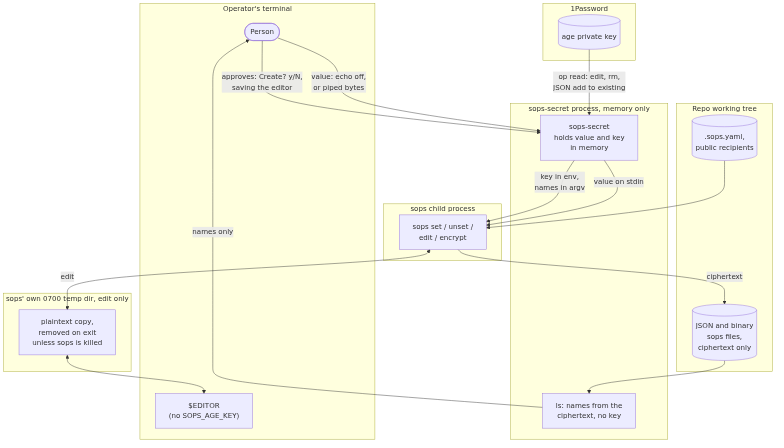
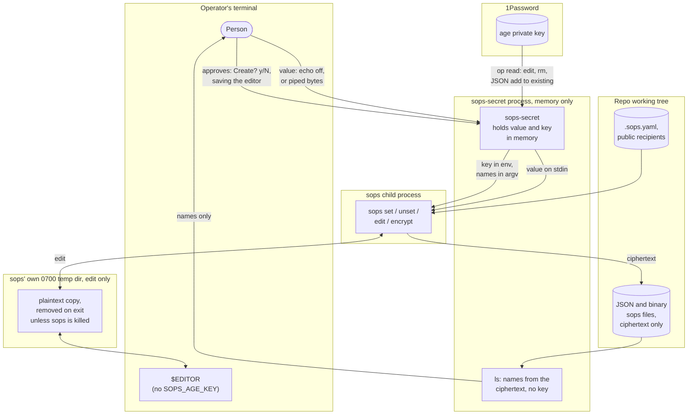

# JSON and binary sops files

Design for [#2](https://github.com/activescott/sops-secret/issues/2): how `edit`, `add`, `rm`
and `ls` handle a JSON sops file (a `.dockerconfigjson`, say) and a binary one (an htpasswd
file encrypted whole). Nothing here is implemented yet. Today
[`formatOf`](https://github.com/activescott/sops-secret/blob/fa84756dcb4ae662a9accbc750a6f17e2f1bba43/src/format.ts?plain=1#L27-L39)
refuses a file that looks like JSON, and a `*.encrypted` name with no other hint fails as an
unknown format.

The guarantee from the README stays: no secret value reaches argv, stdout or stderr, or a
plaintext temp file that sops-secret writes. `edit` keeps its one exception, the plaintext
copy sops itself makes for the editor. sops removes that copy on a clean exit and on Ctrl+C,
but not when it is killed: a SIGPIPE during the invalid-JSON loop left the edited plaintext
in `/tmp/<random>/<basename>`. sops does the same for YAML today.

## Data flow

The trust boundaries are the same as for dotenv and YAML. The person approves in two places:
answering `Create?` before a new file is written, and saving the editor before `edit`
re-encrypts. Replacing a binary file with `add` (below) needs no private key, so that path
never calls `op read`.

## What sops does with each format

Checked by hand against sops 3.13.3 with a throwaway age key. The 3.11 floor is not
re-checked here; the integration tests the implementation adds will run against it in CI.

A JSON file keeps its keys in plaintext and encrypts each leaf, recording the leaf's type in
the ciphertext (`ENC[...,type:str]`, `type:int`, `type:float`). sops refuses a top-level
array.

| Operation                                          | JSON                                                                                        | Binary                                                                          |
| -------------------------------------------------- | ------------------------------------------------------------------------------------------- | ------------------------------------------------------------------------------- |
| On disk                                            | The JSON tree, tab-indented, plus `"sops"`                                                  | `{"data": "ENC[...]", "sops": {...}}`, also JSON                                |
| `--input-type`                                     | `json`                                                                                      | `binary`; any other type shows the wrapper, not the content                     |
| `set --value-stdin '["auths"]["quay.io"]["auth"]'` | Sets it, creating missing parents. Stdin must be JSON, so an object replaces a subtree      | `set '["data"]'` replaces the content, as a JSON string, so UTF-8 only          |
| `set` on an array index past the end               | Appends: `["list"][5]` on a two-element list wrote index 2                                  | n/a                                                                             |
| `set` on another key                               | Normal                                                                                      | `["other"]` is stored and then ignored by binary output                         |
| `unset`                                            | Removes the key; exits 1 with `Key not found: <name>` if absent                             | `unset '["data"]'` leaves a file that fails with `no binary data found in tree` |
| `decrypt --extract '["auths"]["ghcr.io"]["auth"]'` | Prints the plaintext leaf to stdout                                                         | `--extract '["data"]'` prints the content                                       |
| `edit`                                             | Opens the decrypted JSON; on invalid JSON it loops on "Press enter to return to the editor" | Opens the raw content, at `/tmp/<random>/<basename>`                            |
| `encrypt` from stdin                               | Used today by `add` to create a file                                                        | Round-trips arbitrary bytes, including non-UTF-8                                |

sops-secret uses `--extract` nowhere. It prints plaintext to stdout, and no command reads a
value back. The old `sops --set '["k"] "value"'` form takes the value as an argument, where
`ps` shows it, so it stays unused too; `sops set --value-stdin` is the only way a value goes
in, as today.

## Telling the formats apart

sops cannot tell a binary file from a JSON file whose only key is `data`; only
`--input-type` decides. sops-secret decides from the name, then the contents, keeping the
current order for dotenv and YAML:

1. `*.yaml`, `*.yml` and the dotenv names stay as they are.
2. `*.json` and `*.dockerconfigjson` (after stripping `.encrypted`) are JSON.
3. An existing file whose contents parse as a JSON object with a top-level `sops.mac` is
   binary when its only other key is `data` and its `data` is an `ENC[...]` string, and
   JSON otherwise.
4. A new file with any other name is binary only when `add` is given no name (decision 2).

Anything else fails as today with `cannot tell the format`.

## Naming nested JSON keys

Top-level keys that match today's name rule keep the bare name: `sops-secret add app.json
API_KEY`.
Anything deeper is a JSON Pointer ([RFC 6901](https://www.rfc-editor.org/rfc/rfc6901)),
written with a leading `/`: `/auths/ghcr.io/auth`. Pointers suit this because Docker config
keys are hostnames full of dots, and `/` is rare in a key. A `/` or `~` inside a key is
written `~1` or `~0`. sops-secret turns a pointer into the sops index (`["auths"]["ghcr.io"]["auth"]`)
with `JSON.stringify` per segment, as
[`sopsIndex`](https://github.com/activescott/sops-secret/blob/fa84756dcb4ae662a9accbc750a6f17e2f1bba43/src/format.ts?plain=1#L84-L87)
does now. Decision 1 covers the alternatives.

`ls` prints every leaf: bare names for top-level keys that match the name rule, pointers for
everything else, including a top-level key with a space or `@` in it (`/my key`). For JSON,
`add` and `rm` accept a pointer to any object key, refusing only the names under "What the
CLI refuses". So every name `ls` prints for a leaf under objects pastes straight into `add`
and `rm`. Array elements do not: `ls` prints them as `/list/0`, and `add` and `rm` refuse a
path through an array, so those are changed with `edit`.

## Each command

### `ls`

JSON: parse the file with `JSON.parse` in process, check it has `sops.mac`, drop the `sops`
key, and print each leaf path. No key and no sops call, as today.

Binary: print nothing on stdout, and on stderr `<path> is a binary sops file: one value, no
names; use edit`. Exit 0, so scripts that loop over `ls` keep working.

### `add`

JSON, existing file: read the value as today (echo off, or the rest of stdin), then
`sops set --input-type json --output-type json --value-stdin <path> <index>` with
`JSON.stringify(value)` on stdin. Missing parent objects are created, as sops does
(decision 4). The value is always stored as a string; `add` stores what was typed, so for a
`.dockerconfigjson` the person types the base64 `auth` value themselves. Refused when the
target exists and is not a `type:str` leaf (read from the ciphertext, no decrypt), when it
is an object, and when the path goes through an array or through a leaf.

JSON, new file: as today's
[`createWith`](https://github.com/activescott/sops-secret/blob/fa84756dcb4ae662a9accbc750a6f17e2f1bba43/src/cli.ts?plain=1#L171-L201),
building the nested object from the pointer and running `sops encrypt --input-type json
--output-type json`. No private key.

Binary: `sops-secret add <path>` with no name replaces the whole content (decision 2). The
bytes come only from a pipe, read as a Buffer to EOF with no newline trimmed and no UTF-8
decoding, so `htpasswd -nB alice | sops-secret add htpasswd.encrypted` stores exactly what
`htpasswd` wrote. On a terminal it refuses and points to `edit`, since a file typed blind
with echo off is rarely right. The bytes go to `sops encrypt --input-type binary
--output-type binary --filename-override <path>` on stdin, and the ciphertext is written
beside the target and renamed, as `createWith` does (decision 3). A new file still asks
`Create?` first, but stdin is the content, so the answer has to come from somewhere else
(decision 5).

### `rm`

JSON: `sops unset --input-type json --output-type json <path> <index>` for a leaf `ls`
printed, of any type: a number or boolean leaf is removed the same as a string. Refused for
an object (it would drop a subtree whose names were never shown) and
for an array element (removing it renumbers the ones after it). An emptied parent object is
left as `{}`.

Binary: refused with `a binary sops file holds one value; delete the file instead`. sops
would accept `unset '["data"]'` and leave a file it cannot decrypt.

### `edit`

Both formats wrap `sops edit` exactly as today, with `--input-type json` or `--input-type
binary`. For binary the editor sees the raw content. A binary file that is not text will be
mangled by most editors; sops-secret cannot check that without decrypting, so the README
will say to use `add` for those.

## How the guarantee holds

| Command | Format | argv                                | stdout / stderr                                                                       | Plaintext on disk                                                    |
| ------- | ------ | ----------------------------------- | ------------------------------------------------------------------------------------- | -------------------------------------------------------------------- |
| `ls`    | JSON   | none (no child process)             | Key names only. A parse failure says "not valid JSON" without `JSON.parse`'s message  | None                                                                 |
| `ls`    | binary | none                                | A fixed note on stderr                                                                | None                                                                 |
| `add`   | JSON   | Path and index, which are names     | Value goes to sops on stdin. sops' stderr is redacted for the value and its JSON form | None; `set` rewrites the file in place                               |
| `add`   | binary | Path and `--filename-override` only | Bytes go to sops on stdin. stderr redacted for the bytes as a string                  | None; the staging file beside the target is ciphertext               |
| `rm`    | JSON   | Path and index                      | No value is read                                                                      | None                                                                 |
| `rm`    | binary | n/a, refused before any sops call   | Fixed message                                                                         | None                                                                 |
| `edit`  | both   | Path and type flags                 | Editor shows values on the terminal, as today                                         | sops' own temp copy, 0700 dir, removed on exit unless sops is killed |

Two leaks to design out, both checked on Node 24 and sops 3.13.3:

- `JSON.parse` errors quote the input: `Unexpected token 'h', "{"a": hunter2secret}" is not
valid JSON`. A plaintext JSON file passed to `ls` by mistake would print a value. Every
  JSON parse in `format.ts` catches the error and fails with a fixed message.
- When the edited JSON does not parse, sops prints the offending character (`invalid
character 'S' looking for beginning of value`). That is inside `edit`, where values are
  on screen anyway, and sops does the same for YAML today. No change.

The age key reaches sops only through `SOPS_AGE_KEY` and the editor runs without it, as
today.

## What the CLI refuses

- A JSON file with no top-level `sops.mac`: `not sops-encrypted`, without echoing content.
- A top-level `sops` key as a name, or a pointer starting `/sops`.
- An empty pointer segment, and control characters in any name, since `ls` would print them
  to a terminal.
- `add` or `rm` through an array or on an object, and `add` on a non-string leaf. `edit`
  covers these.
- `rm` on a binary file, and `add` with a name on one.
- `add` with no name on a dotenv, YAML or JSON file.
- A JSON Kubernetes Secret (top-level `"kind": "Secret"`). A value under `/data/...` would
  need base64 that `add` does not apply, and the `stringData`/`data` handling exists only
  for YAML. The message points to YAML.

## Open decisions

### 1. Syntax for nested JSON keys

- JSON Pointer, `/auths/ghcr.io/auth`, with bare names for the top level.
- sops' index syntax, `'["auths"]["ghcr.io"]["auth"]'`. Matches sops, but needs shell
  quoting every time.
- Dotted paths, `auths.ghcr\.io.auth`. Short, but every hostname key needs escapes.

Recommendation: JSON Pointer. It is a standard, needs no shell quoting, and hostnames need no
escaping.

### 2. How a binary file is chosen for `add`

- `add <path>` with no name means the whole file, so binary. Existing files are detected by
  shape either way.
- A `--binary` flag on `add`.
- A separate command, such as `put <path>`.

Recommendation: no name means the whole file. A binary file has no names, so the arity says
it, and no flag or new command is needed.

### 3. How `add` replaces a binary file

- `sops encrypt --input-type binary` from stdin, then rename over the target. Any bytes, no
  private key, new data key, recipients from `.sops.yaml` as it is now.
- `sops set --value-stdin '["data"]'` with the content as a JSON string. Keeps the file's
  recipients and needs the private key; UTF-8 content only.

Recommendation: encrypt and rename. htpasswd is text, but other whole-file secrets
(keystores, certificates in DER) are not. If `.sops.yaml` has changed since the file was
written, the replaced file follows the new recipients, which is what `sops updatekeys` would
do anyway.

### 4. Whether `add` creates missing JSON parents

- Create them, as sops does: `add .dockerconfigjson /auths/quay.io/auth` adds `quay.io`.
- Refuse unless the parent object exists, and point to `edit`.
- Ask `Create /auths/quay.io?` first.

Recommendation: create them. The path is typed on purpose, and the message says
`Added /auths/quay.io/auth`, so a typo shows up in `ls` straight after.

### 5. Confirming a new binary file when stdin is the content

- Read the `Create?` answer from `/dev/tty`, and refuse when there is none.
- Skip the prompt for binary, and create on the strength of the pipe.
- Add `--yes` for scripts, and refuse without it when stdin is a pipe.

Recommendation: read `/dev/tty`. It keeps the one approval step `add` has today and works in
the htpasswd pipeline. CI has no terminal, but CI should not be creating secret files.

## Implementation notes

[`run()`](https://github.com/activescott/sops-secret/blob/fa84756dcb4ae662a9accbc750a6f17e2f1bba43/src/sops.ts?plain=1#L19-L22) and
[`sops()`](https://github.com/activescott/sops-secret/blob/fa84756dcb4ae662a9accbc750a6f17e2f1bba43/src/sops.ts?plain=1#L124-L126) take `input?: string`, so binary `add` needs a Buffer path
through both. Redacting sops' stderr for the bytes decoded as a string catches only a
full echo, not a partial one. That is enough for now, since `sops encrypt` echoed no stdin in
any error tried by hand.

## Follow-ups

- README: name JSON sops files `*.json`. A JSON file whose only key is `data`, under any
  other name, is read as binary by rule 3 of "Telling the formats apart".
